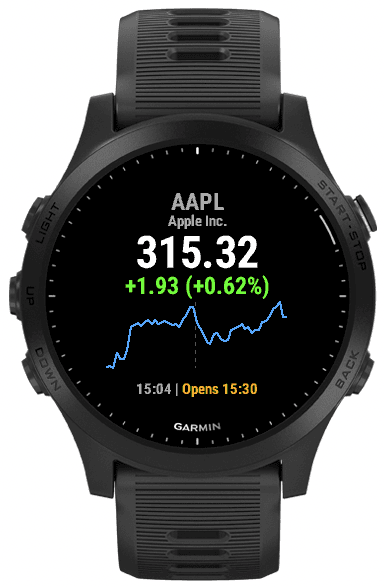
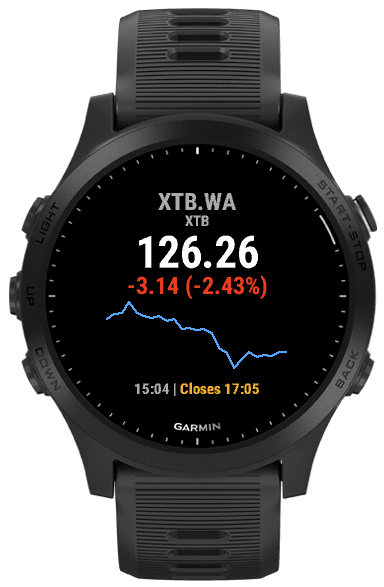
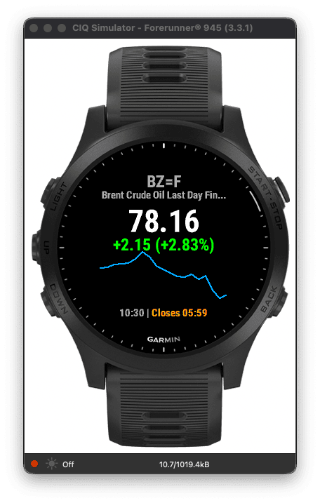
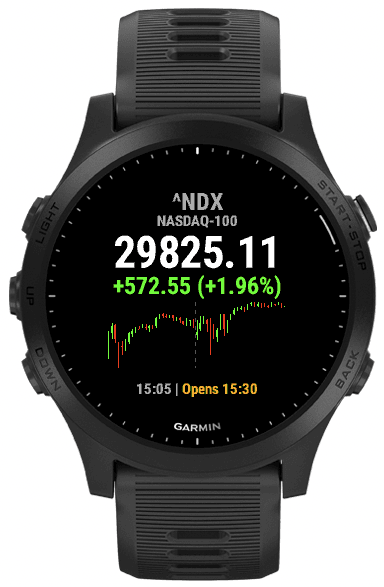
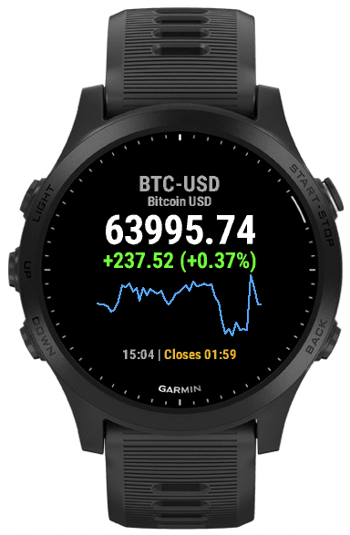

# garmin-one-ticker-stock ⌚📈

📊 Connect IQ widget for Garmin watches - Forerunner 945, tactix 7
(incl. AMOLED / epix Pro Gen 2), Venu 2/3/4 and vívoactive 3/4/5/6 - that
shows the current price and an intraday chart of any stock ticker you
configure in the app settings. The layout scales to every screen size.

Available as **One Ticker Stock** in the official
[Connect IQ Store](https://apps.garmin.com/en-US/apps/f4445669-50fa-4d35-a988-ee1a65721bfb).

## Screenshots 📸

Each screenshot comes from a different watch model:

| Apple                                              | XTB                                              | Brent oil                                          | NASDAQ-100                                             | Bitcoin                                              |
| -------------------------------------------------- | ------------------------------------------------ | -------------------------------------------------- | ------------------------------------------------------ | ---------------------------------------------------- |
| `AAPL`                                             | `XTB.WA`                                         | `BZ=F` (candlestick)                               | `NQ=F` (candlestick)                                   | `BTC-USD`                                            |
| Forerunner 945                                     | vívoactive 5                                     | tactix 7                                           | Venu 3                                                 | epix Pro (Gen 2)                                     |
|  |  |  |  |  |

## Features 🚀

- 💰 Current price with change vs. previous close (green/red)
- 📈 Price chart of 15-minute candles with a configurable window: last 24
  hours (default), last 48 hours, or the last trading session; when the
  window is empty (stock exchanges on weekends, before the session), the
  widget falls back to the last two trading days
- 🕯️ Configurable chart type: line (default) or candlestick
- ✂️ Dashed vertical line marking the break between trading sessions when
  the chart spans more than one (weekends, overnight gaps)
- 🕒 Instrument name and session status (opens/closes/closed) in the
  watch-local time
- 🌍 Any instrument known to Yahoo Finance: stocks (`AAPL`), crypto
  (`BTC-USD`), indices (`^NDX`), futures (`BZ=F`), GPW tickers (`XTB.WA`)
- 💾 Last successful quote cached on the watch - the widget always shows
  data instantly and refreshes in the background
- 🚨 Error states for no phone connection and unknown tickers

## Install from the Connect IQ Store 🏪

Install [One Ticker Stock](https://apps.garmin.com/en-US/apps/f4445669-50fa-4d35-a988-ee1a65721bfb)
from the Connect IQ Store (via Garmin Connect Mobile or the Connect IQ app).
This is the recommended way - app settings (ticker, chart window, chart
type) are then editable from the phone.

## Contributing 🤝

Building, testing, sideloading and the data source are described in [CONTRIBUTING.md](CONTRIBUTING.md).

## License 📄

[The MIT License](https://piecioshka.mit-license.org) @ 2026
